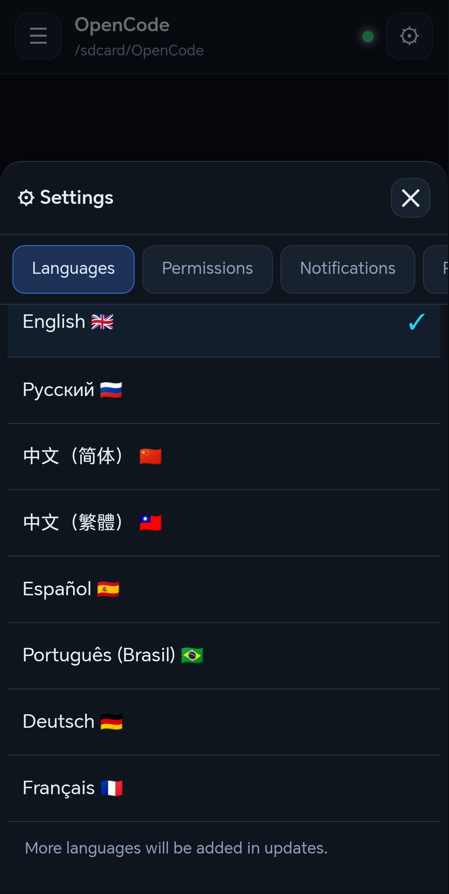
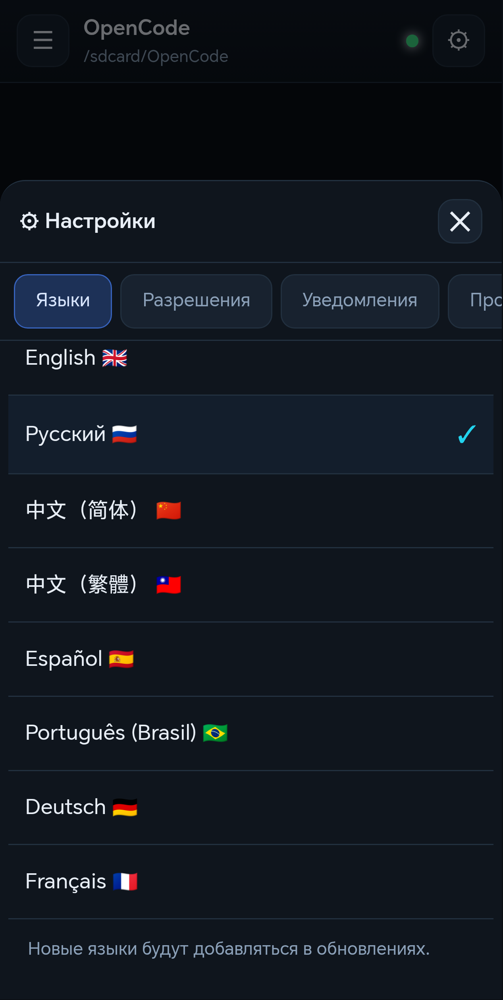
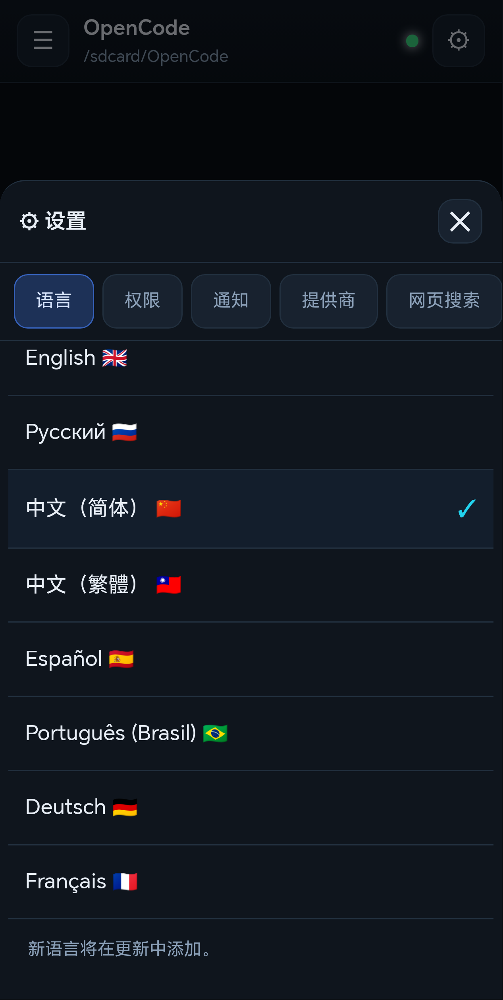
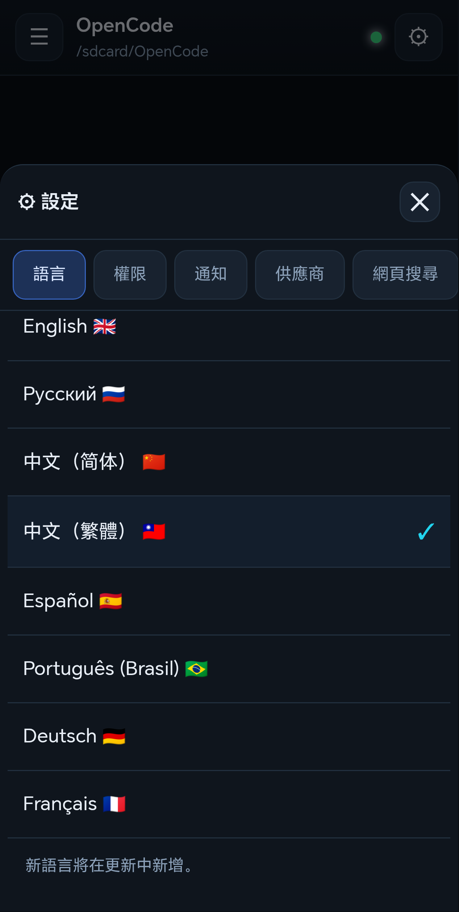
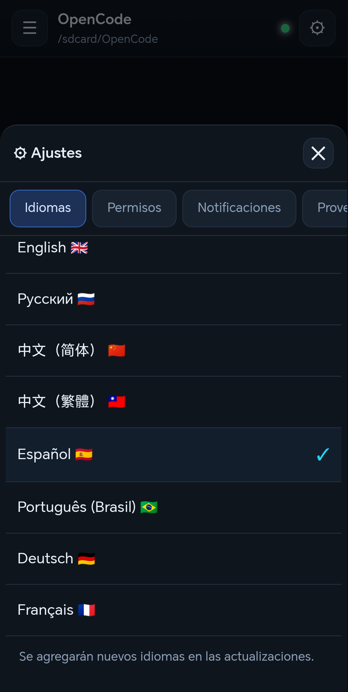
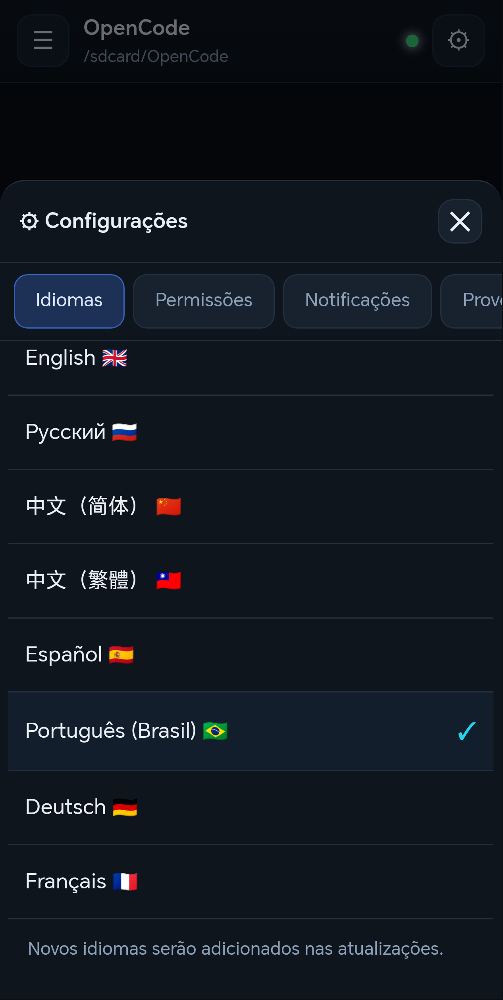
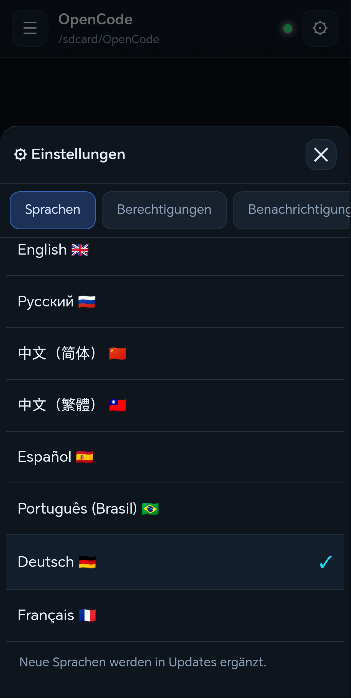
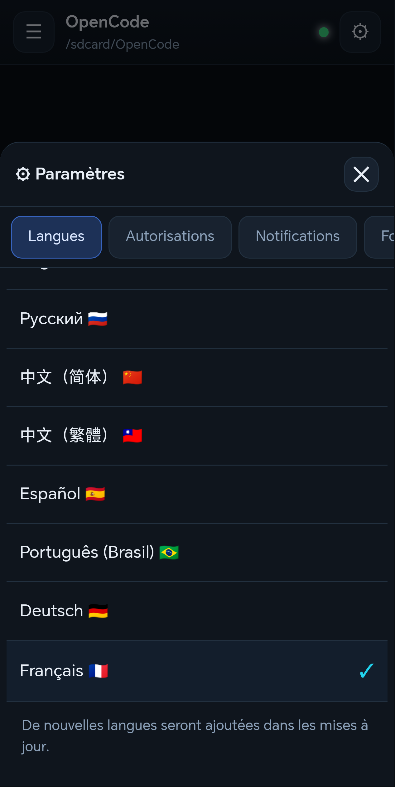

# OpenCode Android

**Languages / Языки:** English 🇬🇧 · Русский 🇷🇺 · 中文（简体） 🇨🇳 · 中文（繁體） 🇹🇼 · Español 🇪🇸 · Português (Brasil) 🇧🇷 · Deutsch 🇩🇪 · Français 🇫🇷

**OpenCode running natively on Android — no PC, no proot, no remote bridge.**

[English](#english) · [Русский](#русский)

---

## English

An unofficial, standalone Android app that embeds the real
[OpenCode](https://github.com/anomalyco/opencode) coding agent (v2.2.6, musl
arm64) together with git, OpenSSH, Python 3.12, Node/Bun wrappers and a local
web UI. Everything runs on the phone: the agent can read/write files, run shell
commands, clone repositories and talk to any model provider.

> Not affiliated with the OpenCode project. OpenCode is MIT-licensed.

### Features

- Real `opencode serve` on `127.0.0.1`, no PC required.
- Chat UI with streaming, reasoning, tool calls, attachments and sessions.
- Generated images/videos from tools are shown inline (file content, file paths
  and markdown images), with an in-app fullscreen viewer.
- Links open in the system browser; a site the agent built (`index.html` in the
  working folder) opens with one tap on the 🌐 chip.
- Provider catalog (239 integrations): API key, OAuth device flow, OpenCode Go.
- Built-in `git` (HTTPS + SSH), `python3`/`pip`, `node`/`bun`/`npx`, `rg`.
- Files on `/sdcard`, project folders, share/attachments.
- Optional full shell access through [Shizuku](https://shizuku.rikka.app/)
  (`uid=2000`): silent package operations, `input`, `am`, `cmd`.
- Web search provider picker (Exa, Firecrawl, Parallel, Tavily, TinyFish).
- Interface languages (switch in **⚙ → Languages**):
  - English 🇬🇧 (default on first launch)
  - Русский 🇷🇺
  - 中文（简体） 🇨🇳
  - 中文（繁體） 🇹🇼
  - Español 🇪🇸
  - Português (Brasil) 🇧🇷
  - Deutsch 🇩🇪
  - Français 🇫🇷
- In-app updates from GitHub Releases.

### Screenshots

| | |
|---|---|
|  |  |
|  |  |
|  |  |
|  |  |

### Install

1. Download `OpenCodeAndroid-<version>.apk` from
   [Releases](https://github.com/MaxKeks88/opencode-android/releases/latest).
2. Allow installing from unknown sources for your browser/file manager.
3. Open the app, grant file access and choose a working folder.
4. Pick a model at the bottom of the screen. Free OpenCode Zen models work
   without an account; add your own provider key in **⚙ → Providers**.

Requirements: Android 8.0+ (API 26), arm64-v8a.

> Android may show a Play Protect warning for apps installed outside Google
> Play. The APK is built from this repository and signed with a stable key;
> checksums are published with every release.

### Updates

The app checks GitHub Releases (at most once every 6 hours or on demand).
When a newer version exists, a small glowing **⟳** appears next to the gear
icon in the side menu. Tap it to read the release notes, download and install.
Updates keep your chats, settings and credentials. The APK is verified by
SHA-256 and by the signing certificate before installation.

You can also check manually in **⚙ Settings → Check app updates**.

### First run tips

- **Files**: the app needs “All files access” to work with `/sdcard`.
- **Working folder**: default `/sdcard/OpenCode`; change it in the header.
- **Providers**: ⚙ → Providers → popular providers or “Show all (239)”.
  API keys and OAuth tokens are stored by OpenCode, never in the app prefs.
- **Shizuku (optional)**: ⚙ → Permissions → “Full access (shell)” and follow
  the on-screen steps. After a reboot Shizuku must be started again.
- **Advanced permissions (optional)**: `tools/enable_powers.bat` grants
  `WRITE_SECURE_SETTINGS`, `DUMP`, `READ_LOGS` via ADB once.

### Build from source

Requirements: JDK 17, Android SDK (build-tools + platform), Python 3.8+,
ADB (for install). Linux, macOS and Windows are supported.

```bash
# 1. download the third-party runtime (~300 MB) from upstream
python tools/fetch_runtime.py

# 2. build and sign
python build_apk.py            # dev build (debuggable, CDP enabled)
python build_apk.py --no-debug # public build (no android:debuggable)

# 3. install
adb install --no-incremental -r -d OpenCodeAndroid.apk
```

`build_apk.py` looks for `keystore.jks` + `keystore.properties`
(`storePassword`, `keyPassword`, `alias`). If they are missing, a development
key with the default password is generated — **do not publish such builds**.
Use `--release` to enforce a real key.

`tools/fetch_runtime.py` reconstructs `runtime/` and `assets/runtime/` from
pinned upstream releases (OpenCode, Alpine Linux 3.24, Python standalone).
Nothing proprietary is stored in this repository.

### Repository layout

| Path | Purpose |
|---|---|
| `app/` | Android sources, manifest, resources |
| `assets/app/` | HTML/JS chat UI and local bridge |
| `assets/runtime/` | musl loader, C++ runtime, `occtl.py` |
| `runtime/` | downloaded binaries (git-ignored) |
| `tools/` | runtime fetcher, smoke tests, ADB helpers |
| `AGENTS.md` | architecture and developer notes (Russian) |
| `docs/LOCALIZATION.md` | translation status and checklist (Russian) |
| `docs/RELEASING.md` | release and GitHub maintenance guide (Russian) |

### Security

- OpenCode and the local HTTP server listen on `127.0.0.1` only.
- All sensitive local routes require a per-install `X-Bridge-Token`.
- Cleartext HTTP is allowed only for `127.0.0.1`/`localhost`.
- Public builds are not debuggable and do not expose WebView debugging.
- Provider keys and OAuth tokens are stored by OpenCode on the device.

Found a security issue? Please open a private report as described in
[SECURITY.md](SECURITY.md).

### License

MIT — see [LICENSE](LICENSE). Bundled third-party components keep their own
licenses; see the license file and `libs/README.md`.

---

## Русский

Неофициальное самостоятельное Android-приложение: внутри APK — настоящий
OpenCode 2.2.6 (musl arm64), git, OpenSSH, Python 3.12, обёртки Node/Bun и
локальный веб-интерфейс. Всё работает на телефоне, без ПК и proot.

### Возможности

- Настоящий `opencode serve` на `127.0.0.1`.
- Чат со стримингом, размышлениями, инструментами, вложениями и сессиями.
- Сгенерированные картинки и видео из инструментов показываются прямо в чате
  (файлы инструмента, пути в тексте, markdown-картинки) с полноэкранным просмотром.
- Ссылки открываются в браузере по умолчанию, а собранный агентом сайт
  (`index.html` в рабочей папке) — одним тапом по чипу 🌐.
- Каталог из 239 провайдеров: ключ, OAuth, OpenCode Go.
- Встроенные `git` (HTTPS и SSH), `python3`/`pip`, `node`/`bun`/`npx`, `rg`.
- Файлы на `/sdcard`, рабочие папки, вложения.
- Опционально полный shell через Shizuku (uid 2000).
- Выбор провайдера веб-поиска.
- Обновление приложения из GitHub Releases.

### Установка

1. Скачайте `OpenCodeAndroid-<версия>.apk` из
   [Releases](https://github.com/MaxKeks88/opencode-android/releases/latest).
2. Разрешите установку из неизвестных источников.
3. Откройте приложение, дайте доступ к файлам и выберите рабочую папку.
4. Выберите модель внизу экрана. Бесплатные модели OpenCode Zen работают без
   аккаунта; свой провайдер — ⚙ → «Провайдеры».

Требования: Android 8.0+ (API 26), arm64-v8a.

### Обновления

Приложение раз в 6 часов (или по кнопке) проверяет релизы на GitHub. Если
есть новая версия, рядом с шестерёнкой в боковом меню появляется жёлтая
стрелка **⟳**. Нажмите её, чтобы прочитать список изменений, скачать и
установить обновление. Чаты, настройки и ключи сохраняются. APK проверяется
по SHA-256 и подписи. Вручную — ⚙ Настройки → «Проверить обновления
приложения».

### Сборка

```bash
python tools/fetch_runtime.py     # скачать сторонний рантайм (~300 МБ)
python build_apk.py               # отладочная сборка
python build_apk.py --no-debug    # публичная сборка без android:debuggable
adb install --no-incremental -r -d OpenCodeAndroid.apk
```

Нужны JDK 17, Android SDK и Python 3.8+. Подпись — `keystore.jks` и
`keystore.properties`; без них создаётся отладочный ключ (для публикации не
подходит). Подробности — в [`AGENTS.md`](AGENTS.md).

### Лицензия

MIT — см. [LICENSE](LICENSE). Сторонние компоненты сохраняют свои лицензии.

---

**Credits:** [OpenCode](https://github.com/anomalyco/opencode),
[Shizuku](https://github.com/RikkaApps/Shizuku-API), Alpine Linux, musl,
OpenSSH, git, Python, ripgrep.
